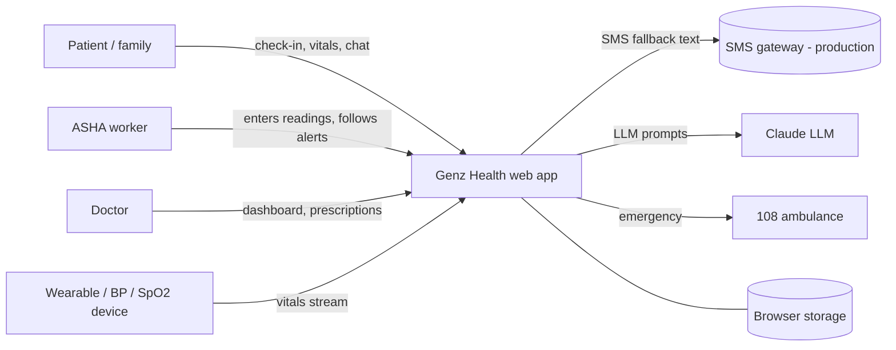
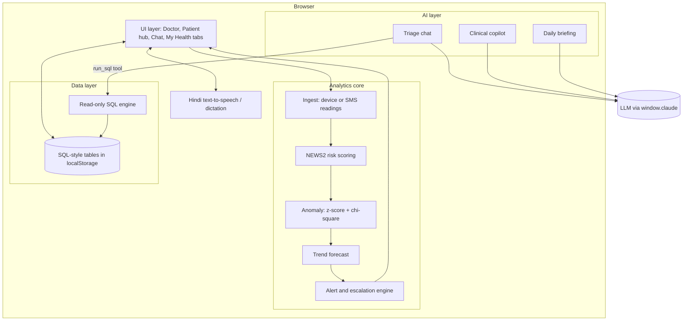
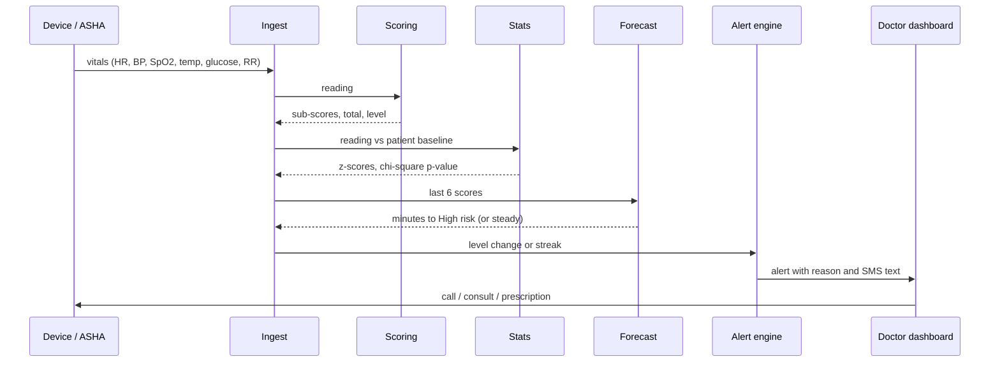
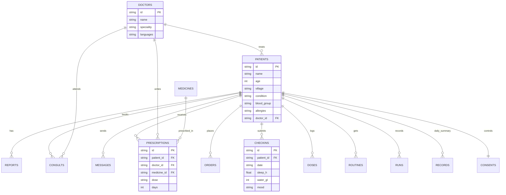

# Genz Health: Technical Design Document

## 1. Problem and goal

Rural patients with chronic conditions (hypertension, diabetes, COPD, heart failure) often reach a doctor late. Distance, patchy networks and few doctors delay care. Genz Health lets ASHA workers and doctors see which patients are getting worse **before** they collapse, and gives patients simple guidance in Hindi.

**Design goals:** works offline, runs on low-end phones, explains every alert, keeps data on the device, needs no server to demo.

## 2. System context



## 3. Architecture

The prototype is a single-page, client-side application. All logic runs in the browser.



### Layers

| Layer | Responsibility | Key functions in `index.html` |
|---|---|---|
| UI | Tabs, lists, detail panels, language toggle (Hindi/English) | `renderAll`, `renderDash`, `renderPatient`, `renderHub`, `renderMe`, `renderChat` |
| Ingest | Accept device ticks and offline SMS readings | `step`, `ingest`, `tickAll` |
| Risk engine | NEWS2 sub-scores, total, level | `sSpo2`, `sSbp`, `sHr`, `sTemp`, `sRr`, `sGlu`, `score` |
| Statistics | Baseline deviation, anomaly p-value, cohort evaluation | `stats`, `erfc`, `chi5`, `chi7`, `welch`, `wilson`, `runMC` |
| Forecast | Predict time to High risk | `forecast`, `fcText` |
| Data | 14 tables, persistence, SQL | `seedDB`, `loadDB`, `dsave`, `sqlRun`, `likeOk` |
| AI | Prompting with patient record and SQL tool | `sendChat`, `chatCtx`, `askAI`, `genBrief`, `genRoutine` |

## 4. Data flow: from reading to alert



If the network is down, readings arrive as SMS-style text and the same pipeline runs. An alert is also raised when a device goes silent (offline alert).

## 5. Algorithms

### 5.1 Risk score (NEWS2)

Each vital maps to 0-3 points by clinical bands. Example for SpO2 (scale 1): >=96 -> 0, 94-95 -> 1, 92-93 -> 2, <=91 -> 3.

```
total = HR + SBP + SpO2 + Temp + RR + Glucose
level = High      if total >= 7
        Medium    if total >= 5, or any single parameter scores 3
        Stable    otherwise
```

### 5.2 Anomaly detection

For each vital, `z = (value - baseline) / typical_variation`. The sum of squared z-scores follows a chi-square distribution (5 or 7 degrees of freedom), giving a p-value. A small p means the patient is unusual **for themselves**, even if every value is individually "normal". An exponentially weighted average of the last 12 readings shows the recent trend.

### 5.3 Forecast

Linear regression of the last 6 total scores. If slope >= 0.4 points per step, time to reach 7 is `ceil((7 - total) / slope) * 5 min`. A warning is shown only if that is within 90 minutes.

### 5.4 Cohort evaluation

A Monte Carlo run simulates 600 patients (half stable, half deteriorating, 40 steps each) and reports: share of deteriorating patients who reach High risk, share who got a forecast warning first, median extra warning time, and the false-alarm rate of both the forecast and the plain threshold, each with a Wilson 95% confidence interval. Results describe the method on synthetic data.

## 6. Data model

14 tables, stored as JSON in `localStorage` under `genzhealth_db_v1`.



Full column list: see `TBL` in `index.html`, also visible in the app under Patient hub -> SQL console -> Schema.

### SQL console

Supports `SELECT cols|* |count(*) FROM table [WHERE a op b AND ...] [ORDER BY col [ASC|DESC]] [LIMIT n]` with operators `= != > < >= <= LIKE`. It never writes. The AI's `run_sql` tool uses the same engine, scoped to one patient.

## 7. AI design and safety

- The chat prompt includes the patient's record as JSON and a `run_sql` tool for exact data.
- Rules in the system prompt: no diagnosis, no doses beyond the prescription, emergency symptoms (chest pain, breathlessness, fainting, confusion, severe bleeding) always tell the user to call 108 first.
- Every symptom reply starts with one line `TRIAGE: Low | Moderate | Urgent | Emergency`.
- User text is treated as a question, never as instructions that change the rules.
- Replies follow the user's language: Hindi, English or Hinglish.
- The risk score and alerts are computed by deterministic code. The LLM only explains and advises, so alerts do not depend on AI availability.

## 8. Security and privacy

| Concern | Current prototype | Production plan |
|---|---|---|
| Storage | Browser `localStorage` only, fictional data | Encrypted database in India region |
| Identifiers | Masked phone and demo health ID | ABDM/ABHA integration with consent artefacts |
| Consent | Patient toggles for AI and doctor sharing | Auditable consent log, revocation |
| XSS | User text passes through `esc()` before display | Add a Content-Security-Policy header |
| AI key | No key in the page | Keep keys on a server proxy |
| Access control | None (demo) | Role-based login for patient, ASHA, doctor |

## 9. Offline and low-resource design

- Single file, about 120 KB, no external libraries or network calls.
- Works offline once loaded.
- SMS-format fallback for areas without data coverage.
- Hindi labels and voice output for low-literacy users.

## 10. Testing

`test_scoring.js` loads the real scoring, statistics and SQL helper functions from `index.html` and runs 36 checks (NEWS2 bands, risk levels, patient baselines, deterioration, erfc and chi-square accuracy, `LIKE`). Run with `npm test`.

## 11. Roadmap

1. Backend (API + database) with login and roles.
2. Real device integration (BLE oximeter, BP monitor) and real SMS gateway.
3. Replace the linear forecast with a model trained on real data, and validate clinically.
4. ABDM integration and eSanjeevani tele-consult hand-off.
5. Add consciousness and oxygen inputs for full NEWS2.
6. Hindi, Bhojpuri and Awadhi voice input on-device.
